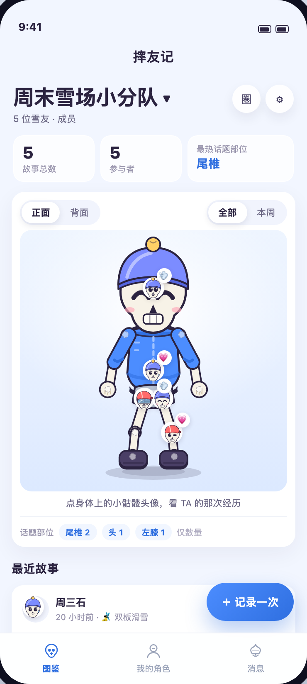

# 摔友记 · V0 本地可玩原型

> 把运动翻车现场，变成朋友们共同的回忆。

这是按 `shaiyouji_implementation_kit/docs/01_摔友记_产品与技术实施方案.md` 落地的 **V0 版本**（含 V0.1 对齐补丁）：
原生 TypeScript 微信小程序 + 本地 mock 数据 + 一套原创分层 Q 版骷髅图鉴。

V0 不接云函数、不录音、不调用 AI，所有数据只保存在本机。V1 的接入位置已经在代码里留好（见 [开发说明](docs/开发说明.md)）。



## 已完成的范围

| 模块 | 内容 |
|---|---|
| 工程 | 原生 TS 小程序、TypeScript 编译插件、`tsc` 严格类型检查、npm 脚本 |
| 角色 | 原创 Q 版骷髅，正/背两套分层素材（身体、头、表情、雪服、帽子、雪镜、护臀、阴影），统一锚点 |
| 图鉴 | 正面 11 / 背面 12 个身体热点、正背面切换、同一部位叠放头像 + `+N`、话题部位、状态贴纸、最近故事 |
| 故事 | 8 条虚构故事（含 1 条无权限测试故事）、2 个可用圈子、匿名展示（不泄露真实 ID）、后续时间线、故事详情 |
| 发布 | 手动文字发布：运动/背景/原因/部位/情况/护具 + 标题/正文/可见圈子或「仅自己可见」/匿名/互动开关 |
| 互动 | 抱抱、转圈、鼓掌、送装备；抱抱/转圈/鼓掌合计每天 3 次；动作与动画分离；减少动效时静态降级 |
| 背包 | 每周免费补给（每人每周 1 次）、库存、赠送（requestId 幂等 + 每日限 3 件） |
| 圈子 | 成员列表、邀请 token、复制邀请路径、退出圈子、非成员访问拒绝 |
| 消息 | 互动收件箱、未读角标、全部已读、点击回放动画 |
| 隐私 | 匿名故事脱敏内部 ID、仅自己可见、作者关闭搞笑动作/收礼、设置页同步、重置演示数据 |
| 校验 | 26 项服务层测试、JSON Schema 校验、素材尺寸/透明度校验、类型检查、WXML 静态检查、17 项浏览器交互回归 |

完整对照见 [设计对照矩阵](docs/设计对照矩阵.md)、[V0 验收记录](docs/V0验收记录.md)；后续缺口设计见 [V1 设计补充](docs/V1设计补充.md)。

## 快速开始

### 方式 A：微信开发者工具（真实小程序）

1. 安装最新版微信开发者工具，选择「导入项目」。
2. 目录选本仓库根目录（`project.config.json` 已配置 `miniprogramRoot: miniprogram/`）。
3. AppID 用测试号即可；`project.config.json` 里默认是 `touristappid`。
4. 项目设置里确认勾选 **TypeScript 编译器插件**（已在 `setting.useCompilerPlugins` 中声明）。
5. 编译后会自动进入「图鉴」页：点身体上的小头像看故事，点右下角「记录一次」发布。

> 说明：本仓库的自动化验证在 Node + 浏览器预览中完成。微信开发者工具未安装在本机，因此 **真机/模拟器编译需要在你的开发工具里再确认一次**（重点看 tabBar 图标、原生 `switch`、`scroll-view` 高度和动画降级）。

### 方式 B：浏览器开发预览（不需要开发者工具）

```bash
npm install
npm run preview      # 生成自包含的 preview/index.html
open preview/index.html
```

预览里可以直接点击：热点抽屉、故事详情、抱抱/转圈/鼓掌/送装备、换表情/雪服、发布新故事。
它是**开发期视觉与交互预览**，不是小程序运行时；真实权限、原生组件和真机性能仍以小程序为准。

交互回归（需要本机 Chrome）：

```bash
npm run preview:qa
npm run shots        # 重新生成 preview/screens 里的文档截图
```

### 方式 C：本地校验

```bash
npm run verify
```

包含：严格类型检查 → 编译 + 26 项服务层测试 → 数据导出 + JSON Schema/业务不变量校验 → 素材尺寸与透明度校验 → WXML 静态检查。

其他脚本：

```bash
npm run assets       # 重新生成全部角色 PNG、tabBar 图标、道具图标与 rig 配置
npm run typecheck    # 只做类型检查
npm run test         # 只跑服务层测试
npm run validate     # 数据与 Schema 校验
npm run check:wxml   # 无 DevTools 时的 WXML 静态检查
```

## 目录结构

```text
fallbuddy/
├── project.config.json        # 微信开发者工具项目配置
├── miniprogram/               # 小程序根目录（云函数接入前全部本地运行）
│   ├── app.{ts,json,wxss}
│   ├── pages/
│   │   ├── atlas/             # 群体战损图鉴（Tab）
│   │   ├── story/detail       # 故事详情 + 动画舞台
│   │   ├── incident/create    # 手动文字发布
│   │   ├── avatar/            # 我的角色 / 换装 / 背包（Tab）
│   │   ├── inbox/             # 互动收件箱（Tab）
│   │   ├── group/             # 圈子成员与邀请
│   │   └── settings/          # 隐私、动效、重置数据
│   ├── components/            # avatar-rig / skeleton-map / story-card / reaction-bar / item-card
│   ├── services/              # api 门面 + 本地 mock（含权限、限频、幂等、赠礼事务）
│   ├── shared/                # 枚举、类型、rig 配置、动作/道具、时间、内容检查
│   ├── mock/fixtures.ts       # 6 位虚构雪友、3 个圈子、8 条故事
│   └── assets/                # 角色分层 PNG、道具图标、tabBar 图标（生成产物）
├── scripts/
│   ├── art/                   # 原创矢量素材源码（SVG 由代码生成，可复现）
│   ├── build-assets.mjs       # SVG → 2x PNG + rig.generated.ts
│   ├── build-preview.mjs      # 生成 browser 预览
│   ├── preview-qa.mjs         # puppeteer 交互回归
│   └── preview-shots.mjs      # 文档截图
├── tests/                     # node:test 服务层测试
├── docs/                      # 开发说明、设计对照矩阵、V1 设计补充、V0 验收记录
├── preview/                   # 生成的开发预览与截图
└── shaiyouji_implementation_kit/  # 原始需求与方案资料（未改动）
```

## 设计取舍

- **所有业务规则都放在服务层**：页面只调用 `services/api`，本地 mock 也严格执行「当前用户身份、圈子成员、可见性、每日限频、requestId 幂等、赠礼原子性」。V1 换云函数时页面不用改。
- **素材可复现**：角色不是手拖的图层文件，而是 `scripts/art/rig-art.mjs` 里的几何定义 + `npm run assets` 导出的 PNG。改颜色/比例/表情后重新导出即可，热点与锚点同步生成。
- **动画是展示层**：动作由 `ActionDefinition` 驱动，客户端本地播放；服务端事实（互动事件、库存变化）不依赖动画完成。开启「减少动效」时只显示静态表情。
- **默认私密**：故事必须逐个勾选可见圈子；分享路径只带 `storyId`，不授予查看权限；匿名只隐藏昵称，后台仍绑定本人。
- **不做付费经济**：所有道具免费、无现金价值、不可交易（除互动道具的赠送）；没有充值、提现、分享换奖励。

## 已知限制（V0 有意不做的）

- 没有云函数/云数据库，数据只在本机；换手机或清缓存后不可恢复。
- 没有圈子创建/加入审批、故事草稿、追加后续、投票、管理员审核页；对应设计见 [V1 设计补充](docs/V1设计补充.md)。
- 没有 AI/ASR、没有语音上传、没有内容安全后台、没有举报处理后台；举报按钮只弹说明。
- 没有真实微信身份映射，当前用户固定为演示用户「小北」。
- 邀请 token 由本地生成，只有过期/使用次数检查；未做服务端签名、撤销列表和加入审批。
- 微信开发者工具未在本机运行过，原生组件与真机性能需要在 DevTools/真机复核。
- 上线前必须完成方案第 13、18.2 节的合规与平台核查（主体、类目、UGC、隐私、备案）。

## 下一步（按方案 V1 顺序）

1. 接 CloudBase 登录与用户，把 `services/api.ts` 换成云函数适配器。
2. 圈子邀请/加入/退出与故事草稿、发布、撤回、审核状态。
3. Avatar 跨设备持久化、免费周补给、赠送事务与台账。
4. 互动事件、收件箱、举报/屏蔽、管理员处理。
5. 之后再评估 V1.1 的语音 + AI 整理、追加后续与同款经历，且必须保留纯文字路径；V1.2 再做投票榜单。

原始方案见 [实施资料包](shaiyouji_implementation_kit/docs/01_摔友记_产品与技术实施方案.md)。

V0.1 已补齐的 5 项：匿名数据脱敏、仅自己可见、状态贴纸、互动合计限次、搞笑动作默认关闭。
